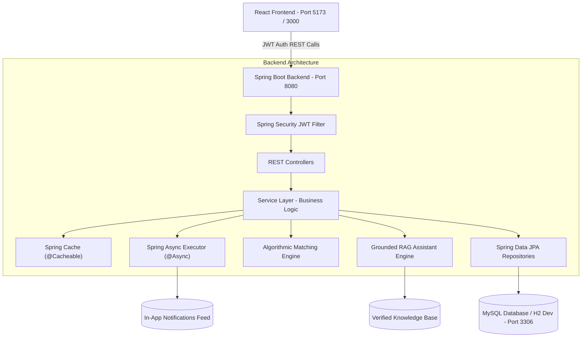
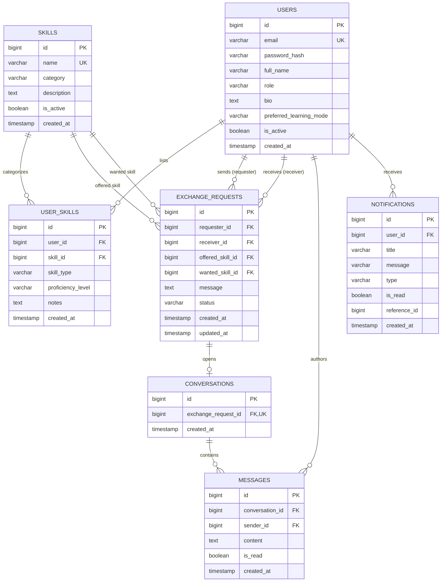

# Skill Exchange Platform
**B.Tech 3rd Year Computer Science and Engineering | Full Stack Development Using Java | Week 15 Capstone**

---

## 1. Project Abstract
The **Skill Exchange Platform** is a web-based educational barter platform designed to democratize learning and skill acquisition. Instead of paying money for courses or hiring commercial tutors, users exchange their skills mutually:
- Every registered user operates under a **dual persona** model—acting simultaneously as an instructor (teaching skills they have mastered) and a learner (acquiring skills they want).
- An algorithmic matching engine pairs users based on **bidirectional complementarity** (e.g., User A teaches Java and wants UI/UX; User B teaches UI/UX and wants Java).
- A structured, transactional state machine manages the end-to-end barter lifecycle: `Discovery` &rarr; `Formal Exchange Request` &rarr; `Review (Accept/Reject)` &rarr; `Direct Chat Coordination` &rarr; `Exchange Completion` &rarr; `History`.

---

## 2. Problem Statement & Objectives
- **Problem**: Many passionate students and self-learners possess valuable skills in programming, design, languages, or communication, but lack financial resources to enroll in expensive certification courses. Existing portals are predominantly commercialized (paid courses, freelance job bidding, or generic social media).
- **Objectives**:
  1. Provide a zero-cost, community-driven skill sharing space.
  2. Implement smart reciprocal partner matchmaking to remove search friction.
  3. Ensure secure, role-based, and transactional coordination between matched peers.
  4. Ground platform questions in a dedicated Retrieval-Augmented Generation (RAG) assistant.

---

## 3. Strict Technology Stack (Full Stack Java Syllabus)

| Layer | Approved Technology | Purpose & Justification |
| :--- | :--- | :--- |
| **Frontend** | React.js (JavaScript, HTML5, CSS3) | Single-page application using modern React Hooks and React Router. No TypeScript or external styling frameworks. |
| **Backend** | Java 21 / 25, Spring Boot 3.3.x | Enterprise REST architecture with Spring Web, dependency injection, and clean service layers. |
| **Security** | Spring Security 6, JWT, BCrypt | Stateless token-based security, BCrypt password hashing, and role-based access (`ROLE_USER`, `ROLE_ADMIN`). |
| **Data Persistence**| Spring Data JPA, Hibernate, MySQL | Relational entity mappings (`@OneToMany`, `@ManyToOne`, `@OneToOne`), transactional integrity (`@Transactional`). |
| **AI & RAG** | Spring Boot RAG Engine | Local knowledge base indexing platform manuals and synthesizing grounded responses with source citations. |
| **Performance** | Spring Cache (`@Cacheable`) | In-memory cache for read-heavy reference data (e.g. skill categories) with cache eviction on updates. |
| **Async Tasks** | Spring Task Execution (`@Async`) | Non-blocking background dispatching of in-app notifications and audit logs. |
| **Monitoring** | Spring Boot Actuator (`/actuator/health`) | Real-time health monitoring and system status inspection. |
| **Testing** | JUnit 5, Mockito, Spring Boot Test | Automated unit and integration testing suite. |
| **DevOps** | Docker, Docker Compose | Multi-stage Dockerfiles and container orchestration for MySQL, Backend, and Frontend. |

---

## 4. System Architecture



---

## 5. Normalized Database Design (ER Diagram)



---

## 6. Pre-Seeded Demonstration Accounts (Week 15 Viva)

| Persona / Role | Email | Password | Pre-Configured Skills |
| :--- | :--- | :--- | :--- |
| **Student 1 (Instructor/Learner)** | `rahul@example.com` | `password123` | Teaches: Java, Spring Boot &bull; Wants: React.js, UI/UX |
| **Student 2 (Instructor/Learner)** | `priya@example.com` | `password123` | Teaches: React.js, UI/UX &bull; Wants: Java, Python |
| **Student 3 (Instructor/Learner)** | `ananya@example.com` | `password123` | Teaches: French, Public Speaking &bull; Wants: Graphic Design |
| **Student 4 (Instructor/Learner)** | `vikram@example.com` | `password123` | Teaches: Graphic Design, Photography &bull; Wants: French |
| **Administrator** | `admin@skillexchange.com` | `adminpassword123` | Platform-wide user moderation, catalog management |

*(Note: Rahul & Priya are an instant 100% reciprocal match! Ananya & Vikram are another instant 100% match!)*

---

## 7. Setup & Execution Instructions

### Prerequisites
- Java JDK 21 or 25 installed
- Apache Maven 3.8+ installed
- Node.js 18+ and npm installed
- *(Optional)* MySQL 8.0 or Docker

### Step 1: Start the Backend (Spring Boot)
Open a terminal in the project root:
```bash
cd backend
mvn spring-boot:run
```
*The backend starts on port **8080**. It automatically seeds sample demonstration data and runs on an embedded in-memory MySQL-compatible database by default.*

To run against a local standalone MySQL instance on port 3306:
```bash
mvn spring-boot:run -Dspring-boot.run.profiles=mysql
```

### Step 2: Start the Frontend (React)
Open a second terminal in the project root:
```bash
cd frontend
npm install
npm run dev
```
*The React application starts on **http://localhost:5173**.*

---

## 8. Running Automated Tests

Run the backend test suite:
```bash
cd backend
mvn test
```
**Test Results**: 6 unit and integration tests covering user registration, duplicate email rejection, JWT authentication, complementary match scoring, grounded RAG question answering, and out-of-scope question handling.

---

## 9. Docker Deployment

Deploy the entire full stack application (MySQL 8 + Spring Boot + React + Nginx) with one command:
```bash
docker-compose up --build
```
- Frontend UI: `http://localhost:3000`
- Backend API: `http://localhost:8080`
- MySQL Database: `localhost:3306`

---

## 10. Complete REST API Endpoints Specification

| Method | Endpoint | Access Role | Description |
| :--- | :--- | :--- | :--- |
| `POST` | `/api/auth/register` | Public | Register new user with hashed password |
| `POST` | `/api/auth/login` | Public | Authenticate user & return JWT token |
| `GET` | `/api/users/me` | USER, ADMIN | Get authenticated user profile |
| `PUT` | `/api/users/me` | USER, ADMIN | Update profile biography and preferences |
| `GET` | `/api/users/{id}` | USER, ADMIN | View public profile of another peer |
| `GET` | `/api/skills` | Public / USER | Fetch catalog skills with category filter |
| `GET` | `/api/skills/categories`| Public / USER | Fetch cached list of distinct skill categories |
| `POST` | `/api/skills` | USER, ADMIN | Create a new skill in platform catalog |
| `GET` | `/api/user-skills/me` | USER, ADMIN | Fetch current user's offered & wanted skills |
| `POST` | `/api/user-skills` | USER, ADMIN | Add a skill to user profile |
| `DELETE`| `/api/user-skills/{id}`| USER, ADMIN | Remove a skill listing from user profile |
| `GET` | `/api/discovery/users` | USER, ADMIN | Search users by keyword, category, proficiency |
| `GET` | `/api/matches/recommendations` | USER, ADMIN | Get algorithmic partner recommendations |
| `POST` | `/api/exchanges` | USER, ADMIN | Submit a skill exchange request |
| `GET` | `/api/exchanges/incoming`| USER, ADMIN | List received exchange requests |
| `GET` | `/api/exchanges/outgoing`| USER, ADMIN | List sent exchange requests |
| `GET` | `/api/exchanges/{id}` | USER, ADMIN | View exchange details and status history |
| `PATCH`| `/api/exchanges/{id}/accept` | USER, ADMIN | Accept an incoming exchange request |
| `PATCH`| `/api/exchanges/{id}/reject` | USER, ADMIN | Reject an incoming exchange request |
| `PATCH`| `/api/exchanges/{id}/cancel` | USER, ADMIN | Cancel an eligible pending outgoing request |
| `PATCH`| `/api/exchanges/{id}/complete`| USER, ADMIN | Mark an accepted exchange as completed |
| `GET` | `/api/conversations` | USER, ADMIN | List active conversation threads |
| `GET` | `/api/conversations/exchange/{id}` | USER, ADMIN | Get conversation linked to an exchange |
| `GET` | `/api/conversations/{id}/messages` | USER, ADMIN | List message history for conversation |
| `POST` | `/api/conversations/{id}/messages` | USER, ADMIN | Send a message to exchange partner |
| `GET` | `/api/notifications` | USER, ADMIN | Get in-app notifications |
| `PATCH`| `/api/notifications/{id}/read` | USER, ADMIN | Mark notification as read |
| `PATCH`| `/api/notifications/read-all` | USER, ADMIN | Mark all notifications as read |
| `GET` | `/api/dashboard/user` | USER, ADMIN | User metrics and top recommendations |
| `GET` | `/api/dashboard/admin` | ADMIN | Platform-wide analytics and overview |
| `GET` | `/api/admin/users` | ADMIN | User management list |
| `PATCH`| `/api/admin/users/{id}/status` | ADMIN | Toggle user active/disabled status |
| `GET` | `/api/admin/skills` | ADMIN | Manage and moderate catalog skills |
| `PATCH`| `/api/admin/skills/{id}/status` | ADMIN | Toggle catalog skill active status |
| `POST` | `/api/ai/chat` | USER, ADMIN | Grounded RAG FAQ assistant response |
| `GET` | `/actuator/health` | Public | Spring Boot Actuator health status check |
